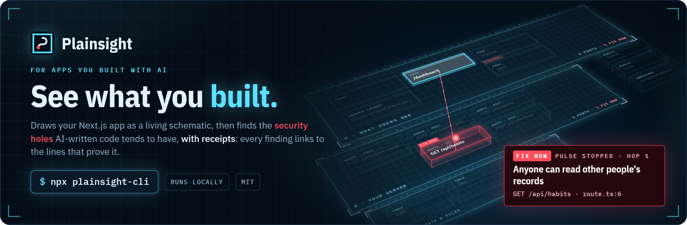
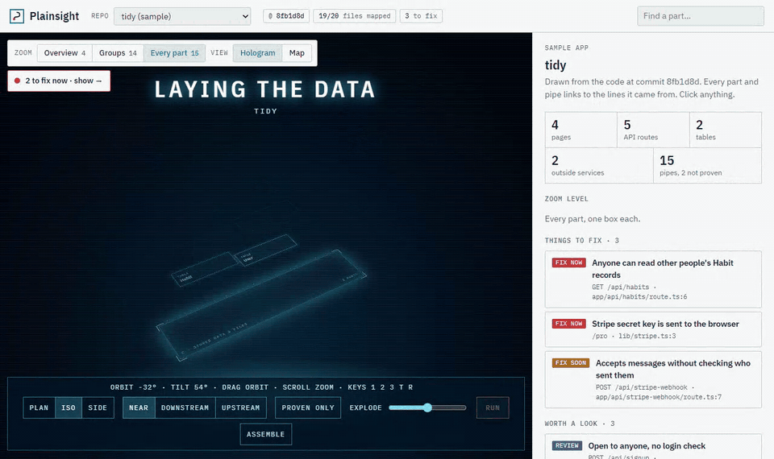
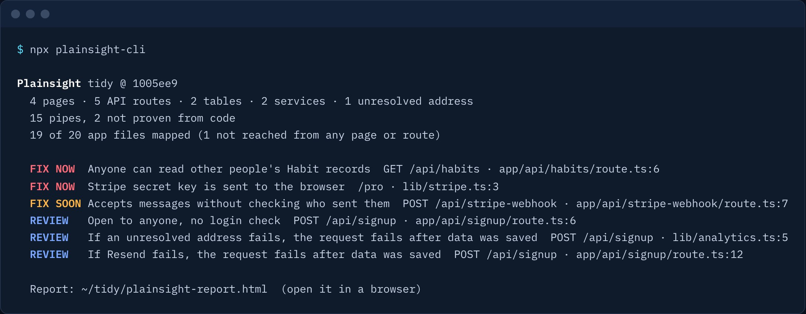
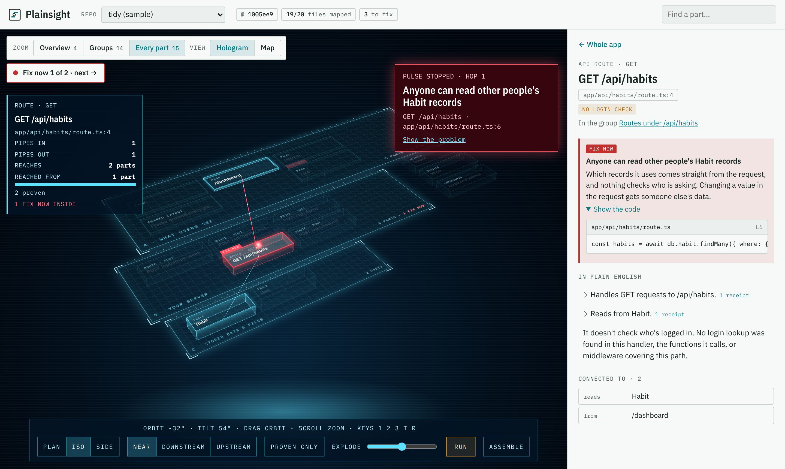
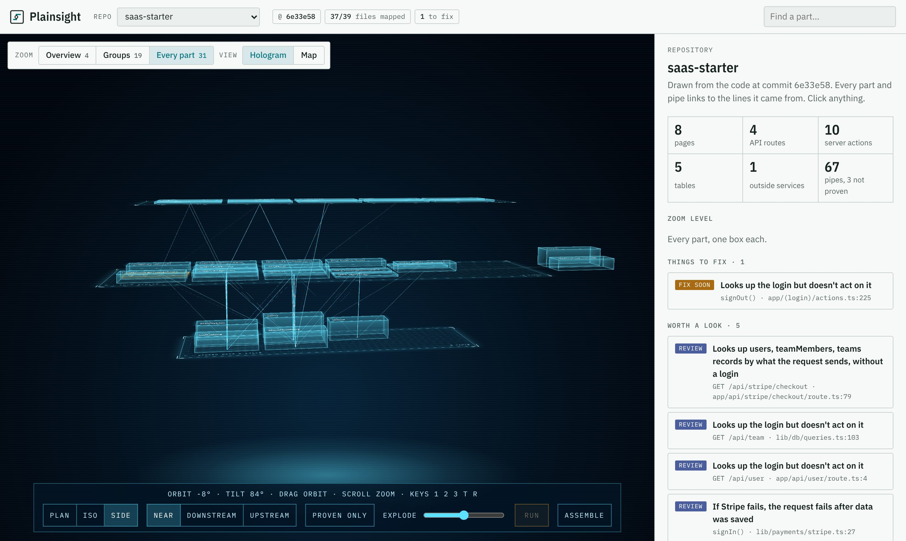

<p align="center">
  
</p>

<p align="center">
  <a href="https://github.com/HonorYourExperiences/plainsight-cli/actions/workflows/test.yml"></a>
  <a href="https://github.com/HonorYourExperiences/plainsight-cli/releases/latest"></a>
  
  
  <a href="LICENSE"></a>
</p>

<p align="center">
  <a href="https://honoryourexperiences.github.io/plainsight-cli/demo.html"><b>Live demo</b></a> ·
  <a href="https://honoryourexperiences.github.io/plainsight-cli/">Website</a> ·
  <a href="#what-it-finds">What it finds</a> ·
  <a href="#install-and-run">Install</a> ·
  <a href="#in-ci-block-pull-requests-that-open-holes">GitHub Action</a> ·
  <a href="https://github.com/HonorYourExperiences/plainsight-cli/issues/new/choose">Report a false alarm</a>
</p>

<br>

**See what you built.** Plainsight reads your Next.js app and draws it as a living schematic: every page, route, table and outside service, and every pipe between them. It finds the security holes AI-written code tends to have, and every box, line and sentence links to the lines of code that prove it.

```bash
npx plainsight-cli
```

One command, in your app's folder. No account, no upload: your code never leaves your machine. You get a summary in the terminal and a single HTML report you can open offline, share or attach to a ticket.

<p align="center">
  <a href="https://honoryourexperiences.github.io/plainsight-cli/demo.html">
    
  </a>
  <br>
  <sub>The report for a sample app: the pulse leaves <code>/dashboard</code> and stops at the first hole it reaches. <a href="https://honoryourexperiences.github.io/plainsight-cli/demo.html">Try it yourself →</a></sub>
</p>

## Why

AI tools let you ship an app without reading every line of it. It works in the demo, so it looks done. What you can't see is the route that returns anyone's data if you change an ID in the address, the secret key that got bundled into the browser, or the webhook that believes any sender. Plainsight shows you, in plain English, with the code to back it up.



## What it finds

| | Finding | What it means |
|---|---|---|
| 🔴 Fix now | **Anyone can read (or change) other people's records** | A route or server action looks records up by something in the request (an ID in the address or the body) and nothing checks who's asking. |
| 🔴 Fix now | **Logged-out visitors pass the ownership check** | The login is only used inside a Prisma filter like `authorId: session?.user.id`. Logged out, that's `undefined`, and Prisma drops `undefined` filters, so the check matches any record. |
| 🔴 Fix now | **Secret key is sent to the browser** | A Stripe, OpenAI, AWS, GitHub, Slack, Resend or Anthropic secret is in code that ends up in the visitor's browser. |
| 🟠 Fix soon | **Accepts messages without checking who sent them** | A webhook changes your database but never verifies the sender's signature. |
| 🟠 Fix soon | **Login check only covers one case** | The request is stopped for one condition, and everything else gets through. |
| 🟠 Fix soon | **Calls a route that doesn't exist** | A page calls `/api/...` with no matching route or method. |
| 🔵 Review | Open routes, outside calls that can fail after data was saved, public-by-design lookups | Things worth a look that are often intended. |

Every finding comes with its **receipts**: the exact lines, in order, from the entry point to the problem. Anything the code can't prove (who calls a webhook, an address built at runtime) is labeled *inferred* or *unresolved*, never drawn as fact.

## The report



- **Hologram.** Your app as floating layers: what users see, code in the browser, your server, stored data, with outside services alongside. Parts stand as tall as the number of pipes that come into them, so the code everything depends on forms the skyline. Light flows along each pipe in the direction the data goes. Drag to orbit, or press 1, 2 or 3 for plan, iso and side views.
- **Run.** Pick a part and press Run. A pulse follows the real pipes and stops at the first "Fix now" problem it reaches.
- **Trace.** Downstream shows everything a part reaches; Upstream shows everything that reaches it, with hop counts.
- **Plain English.** Every part explains itself ("It sends requests to GET /api/habits…"), and every sentence opens to the code it came from.
- **Big apps.** Three zoom levels (Overview, Groups, Every part). Groups state the rule that formed them.
- **Map.** A flat, laid-out drawing for when you want a diagram rather than a hologram.



## Install and run

Plainsight needs Node.js 18 or newer.

```bash
npx plainsight-cli                       # the app in the current folder
npx plainsight-cli ../my-app --open      # another folder, then open the report
npx plainsight-cli vercel/ai-chatbot     # any public GitHub repo (cloned to a temp folder, then deleted)
npx plainsight-cli apps/web              # one app inside a monorepo
```

Or install the `plainsight` command once with `npm install -g plainsight-cli`. Before the npm release, run it straight from GitHub with `npx github:HonorYourExperiences/plainsight-cli`.

| Option | What it does |
|---|---|
| `-o, --out <file>` | Where to write the report (default `plainsight-report.html`) |
| `--open` | Open the report in your browser |
| `--json <file>` | Also write the raw graph as JSON |
| `--markdown <file>` | Also write a Markdown summary (CI job summaries, PR comments) |
| `--fail-on crit\|warn` | Exit with code 1 on "Fix now" (`crit`) or "Fix soon" (`warn`) findings |
| `--no-report` | Terminal summary only |
| `--cdn` | Load the layout engine from a CDN instead of building it in (smaller file, needs internet) |
| `-q, --quiet` | Only the report path and problems |

## In CI: block pull requests that open holes

```yaml
# .github/workflows/plainsight.yml
name: plainsight
on: [pull_request]
jobs:
  plainsight:
    runs-on: ubuntu-latest
    steps:
      - uses: actions/checkout@v4
      - uses: HonorYourExperiences/plainsight-cli@v0.3.0
        with:
          path: .          # or apps/web in a monorepo
          fail-on: crit    # crit, warn or none
```

The check fails on "Fix now" findings, writes the findings table into the run's summary, and uploads the HTML report as an artifact.

## What it reads

- **Next.js:** App Router and Pages Router (pages, layouts, API routes, server actions, middleware), following calls across files, through wrappers like `withUser(...)`, safe-action clients, `cache()`, re-exports and rendered components.
- **Databases:** Prisma, Drizzle (`pgTable`, `mysqlTable`, `sqliteTable`) and Supabase (`from()` calls, SQL schema files, row-level security, admin key).
- **Logins:** `auth()`, `getServerSession`, `getSession`, `currentUser`, Supabase `auth.getUser()`, wrappers that call them, and signed tokens or signatures (`verify…Token()`, `verify…Signature()`, `timingSafeEqual`).
- **Outside services:** Stripe, Resend, OpenAI and other SDKs, plus `fetch` to outside addresses.
- **Plain static sites:** HTML pages and their scripts, ES modules, workers, saved browser data (`localStorage`, IndexedDB, Cache Storage) and Cloudflare Workers.

## What it can't see (yet)

Plainsight reads structure. It never runs your app, so:

- A check that happens *after* a lookup (for example a password checked after loading a shared dashboard) isn't recognised.
- Login helpers with unusual names are missed and show as "no login check". Wrapping them in a function with a common name, or opening an issue, fixes it.
- "Other people's records" needs a table with an owner column (`userId`, `teamId`, `workspaceId`…); others go to review.
- Other frameworks (Remix, SvelteKit, Express, Rails) aren't read yet.

Every report has a **Coverage** section listing the files it read, left out and couldn't reach, so you always know what the drawing covers.

## Privacy

Plainsight runs entirely on your machine. It makes no network requests except `git clone` when you pass a repo URL, and the report loads nothing from the internet unless you pass `--cdn`. There is no telemetry.

## Use it as a library

```js
import fs from "node:fs";
import { analyze } from "plainsight-cli";
import { renderReport } from "plainsight-cli/report";

const graph = analyze("path/to/repo");
fs.writeFileSync("report.html", renderReport([graph]));
```

## Contributing

`npm install`, then `npm test`. `fixtures/tidy` (a sample app with planted bugs) and `fixtures/drizzle-app` hold the patterns the tests require Plainsight to get right. Found a wrong finding? Please open an issue with the code: every false alarm becomes a regression test. See [CONTRIBUTING.md](CONTRIBUTING.md).

- `bin/plainsight.mjs`: the command.
- `src/analyze.mjs`: reads a repo with the TypeScript parser and returns the graph (parts, pipes, findings, unknowns, coverage).
- `src/report.mjs` + `viewer/template.html`: turn graphs into the report page.
- `action.yml`: the GitHub Action.
- `docs/`: the website, demo report and the [MVP definition](docs/MVP.md).

## License

[MIT](LICENSE)
